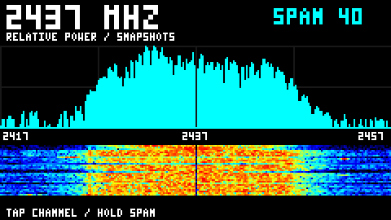

# ESP32-S2 tuning range: method and results

How far the ESP32-S2's 2.4 GHz receive path really tunes, measured with two
boards: an Adafruit ESP32-S2 TFT Feather (receiver, LCD firmware) and a
LOLIN S2 Mini (tone source). The firmware accepts `FREQ` from 100 to
6000 MHz, but a request only works where the RF PLL can lock.



## Results

| | Feather (RX) | Mini (TX) |
|---|---|---|
| Top, VCO window found | 2728–2729 MHz | 2742 MHz |
| Top, tone received (both boards locked) | **2729 MHz** | n/a |
| Bottom, direct PLL | **2193 MHz** confirmed (2192 marginal) | 2206 MHz |
| Bottom, 5/6 divider (`LOMODE DIV`) | **1828 MHz** confirmed | 1839 MHz |
| Stock automatic tuning | 1842–2729 MHz | 1842–2742 MHz |

- Both chips span about 536 MHz of PLL frequency, offset by about 14 MHz
  from each other. Expect a few MHz of chip-to-chip and thermal variation.
- At both ends the VCO capacitor bank runs out. Near the top the chosen
  code falls to 0, and above it all 512 codes flag "VCO too slow". At the
  bottom, 507 of 512 codes flag "too fast".
- **A one-code window is not proof of lock.** At 1827 MHz (divider) the
  window search succeeds, but the received tone lands 100–190 kHz off its
  predicted position. Everywhere listed as confirmed, the tone is within a
  few kHz of the prediction. The boards differ by a steady ~29 ppm.
- Above the ceiling, `FREQ` still answers `OK` and captures still return
  data. It isn't from the requested frequency: bursts at "2760" and "2900 MHz" look
  like 2.4 GHz Wi-Fi. Check `PLL?` before trusting a capture.
- Below about 2.1 GHz, received tone level drops (≈48 dB above the noise at 2100 MHz,
  ≈25 dB at 1850 MHz). Use RX gain 50 there; gain 30 missed the tone.

## Firmware commands used

| Command | Board | Effect |
|---|---|---|
| `PLL?` | any S2 build | Result of the last VCO window search: `ok`, `best` (window width), `cap` (chosen code), `f4`/`f8` (codes flagging each side), `div` (5/6 mode) |
| `LOMODE AUTO\|DIRECT\|DIV` | any S2 build | Force direct PLL or the 5/6 divider (diagnostic, volatile) |
| `TXTONE <count> <period_ms> <gain> [lo_mhz]` | `-DS2_TARGET_TONE_TEST=ON` | Bounded tone bursts at LO + 4.264784 MHz. Refuses with `ERR tx_unlocked` if the VCO search fails |

## Building

```sh
# Feather TFT receiver (LCD spectrum/waterfall, PSRAM)
idf.py -B build-feather -DIDF_TARGET=esp32s2 -DSDKCONFIG=sdkconfig.feather \
  "-DSDKCONFIG_DEFAULTS=sdkconfig.defaults;sdkconfig.defaults.esp32s2;sdkconfig.defaults.feather" \
  -DESP_SDR_FEATHER_TFT=ON build

# Tone source (any ESP32-S2 board)
idf.py -B build-tone -DIDF_TARGET=esp32s2 -DSDKCONFIG=sdkconfig.tone \
  "-DSDKCONFIG_DEFAULTS=sdkconfig.defaults;sdkconfig.defaults.esp32s2" \
  -DS2_TARGET_TONE_TEST=ON build
```

Use the ESP-IDF commit pinned for `esp32s2` in `firmware-targets.json`.

## Tools

Python 3 with `pyserial` and `numpy`. Opening the S2's USB CDC port reboots
the board, and toggling DTR/RTS can leave it in ROM download mode. The scripts
hold both lines low, wait for boot, and resynchronize with `SYNC`.

- `sweep.py PORT START STOP STEP [--gain N] [--lomode M]` writes per-step
  `PLL?` data and power stats to CSV, the spectra to `.npz`, and a waterfall
  to PNG. Receive only.
- `burstcount.py PORT MHZ...` measures the share of bursty captures per
  frequency (ambient-signal check). Receive only.
- `verify_edges.py MINI FEATHER --shielded TX[:RX[:MODE[:EXPECT_MHZ]]] ...`
  runs the transmitter-to-receiver tone check. Confirmation requires at least 2
  transmitter-on captures whose peak beats every transmitter-off capture by 10 dB
  and the local noise floor by 15 dB. `--rate 1` captures at 40 MS/s, allowing
  ±20 MHz offsets when the source can't reach the receiver's LO.

**Transmit tests:** the tone frequencies here are outside the Wi-Fi channel
grid and partly in licensed or protected bands (2690–2700 MHz is a passive
radio-astronomy band; aviation radar starts at 2700). Run them only with both boards in
an RF-shielded enclosure or with a cable and attenuator between them.
`verify_edges.py` refuses to run without `--shielded`.

## Data in `results/`

- `*.csv`: sweeps (`coarse`, `edge*`: Feather top; `low-*`: Feather
  bottom; `mini-*`: Mini edges).
- `verify-*.json`: transmitter-to-receiver checks: `control` (2294 MHz and a
  1 MHz retune), `edges`, `top`, `floor2` (40 MS/s floor), `lowgain`
  (gain 50, 1842–2100 MHz) and `divider` (both boards' 5/6 dividers engage).
- `coarse-waterfall.png`: one row per 20 MHz step from 2400 to 3600 MHz.
